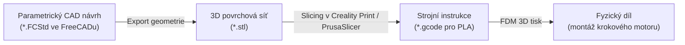

# 3D Print Stepper Mounts (Držáky a nosiče krokových motorů)

> Parametrické 3D modely ve FreeCADu, exportované STL sítě a připravené tiskové G-code soubory pro robustní montážní nosiče a distanční adaptéry krokových motorů (standard NEMA 17).

**Stav projektu:** Dokončeno / Ověřeno tiskem | **Hlavní technologie:** FreeCAD (PartDesign), STL, G-code (Creality Print, PLA)

---

## 1. Účel a funkce

Projekt poskytuje ucelenou sadu mechanických komponent navržených pro přesnou a pevnou fixaci krokových motorů (NEMA 17) v laboratorních, mechatronických a robotických aplikacích.

### Hlavní komponenty v repozitáři:
1. **Nosič motoru (`krok-motor-nosic-v1`):**
   - Masivní konzolový nosič s montážním límcem pro tělo krokového motoru.
   - Integrované kapsy a zahloubení pro zapuštěné šrouby M3/M4.
   - Součástí je samostatný G-code i hromadný layout pro tisk 4 kusů najednou (`krok-motor-nosic-v1-4ks.gcode`).
2. **Montážní adaptér a distanční příruba (`krok-motor-v1` / `v2`):**
   - Rotačně-symetrická distanční redukce motoru s montážními otvory.
   - Optimalizováno pro rychlý tisk bez nutnosti podpěr (přemostění).
   - Verze `v2` obsahuje odladěnou geometrii; k dispozici je i tisková dávka pro 5 kusů (`krok-motor-v2-5ks.gcode`).
3. **Plošný nosič / základová deska motoru (`nosic-motoru-2`):**
   - Plochý montážní nosič (půdorys 70 × 50 mm, tloušťka 5 mm) pro uchycení motoru k základové konstrukci nebo hliníkovým profilům.
   - Zachyceny 4 vývojové iterace (`v1` až `v4`) s postupnými úpravami roztečí a průměrů otvorů.

---

## 2. Výrobní postup a workflow

Všechny díly byly navrženy plně parametricky v prostředí **FreeCAD (PartDesign Workbench)** s důrazem na vyrobitelnost technologií FDM/FFF bez nutnosti generování dočasných podpěr (support-free design).



---

## 3. Struktura projektu

```text
freecad/
├── .gitignore                          # Ignorování záložních souborů FreeCADu (*.FCBak)
├── README.md                           # Tato dokumentace
│
├── krok-motor-nosic-v1.FCStd           # Zdrojový parametrický model nosiče motoru
├── krok-motor-nosic-v1.stl             # STL model nosiče
├── krok-motor-nosic-v1.gcode           # Tiskový soubor pro 1 ks (Creality Print, PLA)
├── krok-motor-nosic-v1-4ks.gcode       # Tiskový soubor pro sérii 4 ks
│
├── krok-motor-v1.FCStd                 # Zdrojový model distanční příruby v1
├── krok-motor-v1.stl                   # STL model příruby v1
├── krok-motor-v1.gcode                 # Tiskový soubor v1
├── krok-motor-v1_PLA_1h1m.gcode        # Optimalizovaný tisk v1 (doba tisku 1 h 1 min)
├── krok-motor-v1_PLA_1h4m.gcode        # Alternativní profil v1 (doba tisku 1 h 4 min)
├── krok-motor-v2.stl                   # Odladěný STL model příruby v2
├── krok-motor-v2.gcode                 # Tiskový soubor v2 (1 ks)
├── krok-motor-v2-5ks.gcode             # Tiskový soubor pro sérii 5 ks
│
├── nosic-motoru-2-v1.FCStd             # Zdrojový parametrický model základové desky
├── nosic-motoru-2-v1.stl               # STL model základové desky v1
├── nosic-motoru-2-v1.gcode             # Tiskový soubor desky v1
├── nosic-motoru-2-v1_PLA_1h58m.gcode   # Tiskový profil desky v1 (doba tisku 1 h 58 min)
├── nosic-motoru-2-v2.stl               # STL model desky v2
├── nosic-motoru-2-v2.gcode             # Tiskový soubor desky v2
├── nosic-motoru-2-v3.stl               # STL model desky v3
├── nosic-motoru-2-v3.gcode             # Tiskový soubor desky v3
├── nosic-motoru-2-v4.stl               # STL model desky v4
└── nosic-motoru-2-v4.gcode             # Tiskový soubor desky v4
```

---

## 4. Doporučené parametry 3D tisku

Předpřipravené G-code soubory byly generovány v prostředí **Creality Print (V7.3+)** pro tiskárny s vyhřívanou podložkou (např. Creality Ender 3 / K1 / Prusa i3 MK3S/MK4):

| Parametr | Hodnota | Poznámka |
| :--- | :--- | :--- |
| **Materiál** | PLA (1.75 mm) | Lze tisknout i z PETG / ABS / ASA pro vyšší teplotní odolnost |
| **Průměr trysky** | 0.4 mm | Standardní mosazná tryska |
| **Výška vrstvy** | 0.20 mm | Optimální poměr rychlosti a rozměrové přesnosti závitů |
| **Teplota trysky** | 200 °C | První i další vrstvy |
| **Teplota podložky** | 60 °C | Vyhřívaná PEI / texturovaná podložka |
| **Výplň (Infill)** | 20–30 % (Grid / Gyroid) | Pro namáhané držáky motoru doporučeno min. 4 obvodové stěny (perimetry) |
| **Podpory** | Vypnuto | Všechny geometrie jsou navrženy samonosně s úhly do 45° |
| **Rozměr podložky** | min. 220 × 220 mm | Vyhovuje většině standardních stolních tiskáren |

---

## 5. Úpravy modelů

1. Otevřít příslušný soubor `*.FCStd` v aplikaci **FreeCAD** (doporučena verze 0.20 nebo novější).
2. Přepnout se do **PartDesign Workbench**.
3. Rozkliknout strom těla (`Body`) a upravit kóty v příslušném náčrtu (`Sketch` / `Sketch001`).
4. Po úpravě provést export těla přes **File -> Export -> STL Mesh (*.stl)**.
5. Načíst STL do oblíbeného sliceru (PrusaSlicer, Creality Print, OrcaSlicer, Cura) a vygenerovat G-code.

---

## 6. Vazby a historie verzí

- **Krokové motory:** Geometrie montážních otvorů odpovídá průmyslovému standardu **NEMA 17** (čtvercová příruba 42.3 mm, rozteč montážních šroubů 31 mm, průměr středícího osazení 22 mm).
- **Vývojové iterace nosiče 2:** Soubory `nosic-motoru-2-v1` až `v4` zachycují iterativní zpřesňování montážních vůlí pro různé typy mechatronických konstrukcí v rámci laboratorních projektů.
