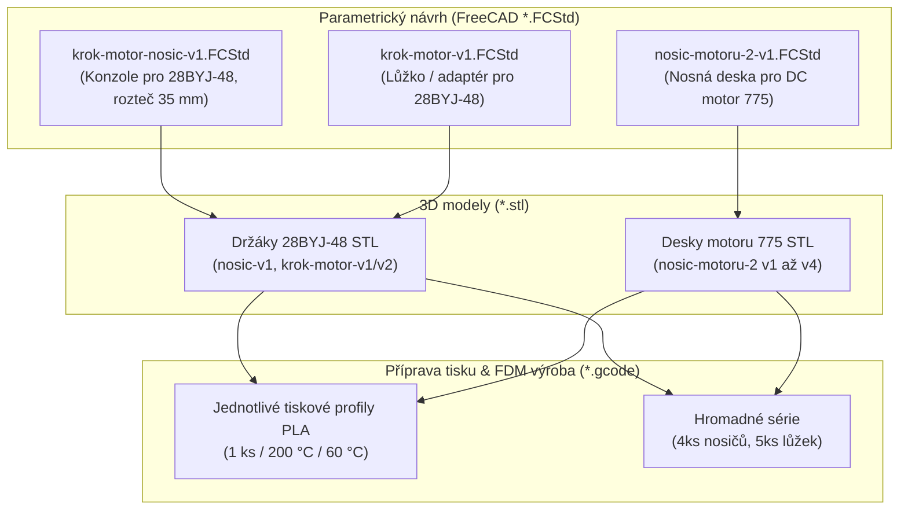

# 3D Print Stepper & DC Motor Mounts (Držáky motorů 28BYJ-48 a 775)

> Parametrické 3D modely ve FreeCADu, exportované STL sítě a připravená tisková data (G-code) pro montážní držáky, nosné desky a adaptéry krokových motorů **28BYJ-48** a stejnosměrných motorů **DC 775**.

**Stav projektu:** Dokončeno / Ověřeno tiskem | **Hlavní technologie:** FreeCAD (PartDesign), STL, G-code (Creality Print, PLA)

---

## 1. Účel a podporované motory

Repozitář obsahuje mechanické komponenty navržené a odladěné pro spolehlivé upevnění dvou často využívaných typů elektromotorů v mechatronických a robotických aplikacích:

### A. Krokové motory 28BYJ-48 (krokový pohon)
- **Typ pohonu:** 4fázový unipolární krokový motor s integrovanou redukční převodovkou (typicky 5V nebo 12V verze).
- **Mechanické rozměry motoru:** Válcové tělo průměru 28 mm, rozteč montážních poutek **35.0 mm**, zploštělá hřídel (D-shaft) 5 mm.
- **Díly v repozitáři:**
  - `krok-motor-nosic-v1` (půdorys 50 × 35.4 mm, tloušťka 5 mm): Montážní konzole s přesnou roztečí 35 mm pro uchycení poutek motoru k rámu zařízení. K dispozici je samostatný G-code i hromadný layout pro tisk 4 kusů najednou (`krok-motor-nosic-v1-4ks.gcode`).
  - `krok-motor-v1` / `v2` (rozměr 30 × 30 mm, výška 15 mm): Přesné lůžko a distanční adaptér vymezující polohu těla motoru a chránící výstupní převodovku. Verze `v2` obsahuje odladěné vnitřní zaoblení; součástí je i tiskový balík pro sérii 5 kusů (`krok-motor-v2-5ks.gcode`).

### B. Stejnosměrné motory typ 775 (vysokoobrátkový výkonový DC motor)
- **Typ pohonu:** Výkonný komutátorový stejnosměrný motor velikosti 775 (12 V / 24 V, vysoké otáčky i točivý moment).
- **Mechanické rozměry motoru:** Vnější průměr pláště motoru cca 42–44 mm, čelní montážní otvory M4 s roztečí **29.0 mm**.
- **Díly v repozitáři:**
  - `nosic-motoru-2` (půdorys 70 × 50 mm, tloušťka 5 mm): Nosná základová deska s montážními otvory M4 dimenzovaná pro přenos krouticího momentu a eliminaci vibrací motoru 775.
  - V repozitáři jsou zachyceny 4 vývojové iterace (`nosic-motoru-2-v1` až `v4`) s postupnými úpravami montážních tolerancí a průměrů otvorů pro různé výrobní šarže motorů a typy šroubů.

---

## 2. Výrobní postup a workflow

Všechny modely byly vytvořeny v CAD systému **FreeCAD (PartDesign Workbench)** s důrazem na vyrobitelnost na běžných FDM 3D tiskárnách bez nutnosti tiskových podpor (support-free konstrukce).



---

## 3. Struktura projektu

```text
freecad/
├── .gitignore                          # Ignorování záložních souborů FreeCADu (*.FCBak)
├── README.md                           # Tato dokumentace
│
├── [ 28BYJ-48 – Nosič motoru ]
├── krok-motor-nosic-v1.FCStd           # Zdrojový parametrický model konzoly (rozteč 35 mm)
├── krok-motor-nosic-v1.stl             # STL model nosiče (50 × 35.4 × 5 mm)
├── krok-motor-nosic-v1.gcode           # Tiskový soubor pro 1 ks (Creality Print, PLA)
├── krok-motor-nosic-v1-4ks.gcode       # Tisková dávka pro 4 ks najednou
│
├── [ 28BYJ-48 – Lůžko a adaptér ]
├── krok-motor-v1.FCStd                 # Zdrojový model distančního lůžka v1
├── krok-motor-v1.stl                   # STL model v1 (30 × 30 × 15 mm)
├── krok-motor-v1.gcode                 # Tiskový profil v1
├── krok-motor-v1_PLA_1h1m.gcode        # Optimalizovaný tisk v1 (doba 1 h 1 min)
├── krok-motor-v1_PLA_1h4m.gcode        # Alternativní profil v1 (doba 1 h 4 min)
├── krok-motor-v2.stl                   # STL model v2 s upraveným vnitřním profilem
├── krok-motor-v2.gcode                 # Tiskový profil v2 (1 ks)
├── krok-motor-v2-5ks.gcode             # Tisková dávka pro 5 ks najednou
│
└── [ DC Motor 775 – Nosná deska ]
    ├── nosic-motoru-2-v1.FCStd         # Zdrojový parametrický model základové desky 775
    ├── nosic-motoru-2-v1.stl           # STL model desky v1 (70 × 50 × 5 mm)
    ├── nosic-motoru-2-v1.gcode         # Tiskový soubor desky v1
    ├── nosic-motoru-2-v1_PLA_1h58m.gcode # Tiskový profil desky v1 (doba 1 h 58 min)
    ├── nosic-motoru-2-v2.stl           # STL model desky v2
    ├── nosic-motoru-2-v2.gcode         # Tiskový profil desky v2
    ├── nosic-motoru-2-v3.stl           # STL model desky v3
    ├── nosic-motoru-2-v3.gcode         # Tiskový profil desky v3
    ├── nosic-motoru-2-v4.stl           # STL model desky v4
    └── nosic-motoru-2-v4.gcode         # Tiskový profil desky v4
```

---

## 4. Doporučené parametry 3D tisku

Předpřipravené G-code soubory byly generovány v prostředí **Creality Print (V7.3+)** pro tisk z PLA na podložce 220 × 220 mm:

| Parametr | Doporučená hodnota | Poznámka |
| :--- | :--- | :--- |
| **Materiál** | PLA (případně PETG / ASA) | Pro motor 775 při vyšší tepelné zátěži je vhodnější PETG nebo ASA |
| **Průměr trysky** | 0.4 mm | Běžná tryska |
| **Výška vrstvy** | 0.20 mm | Vyvážený poměr pevnosti a rychlosti |
| **Teploty** | Tryska 200 °C / Podložka 60 °C | Standardní PLA profil |
| **Výplň (Infill)** | 25–40 % (Gyroid nebo Grid) | Pro nosič motoru 775 doporučeno min. 4–5 plných obvodů (perimetrů) |
| **Podpory** | Vypnuto | Všechny tvary a otvory jsou navrženy samonosně |
| **Rozměr tiskové plochy** | min. 220 × 220 mm | Vyhovuje běžným tiskárnám (Creality Ender 3 / K1, Prusa i3 / MK4) |

---

## 5. Úprava rozměrů ve FreeCADu

Všechny 3 zdrojové soubory `*.FCStd` mají parametrický strom v **PartDesign Workbench**:
1. Otevřít příslušný soubor ve **FreeCADu** (verze 0.20+).
2. Rozbalit tělo `Body` $\to$ rozkliknout `Sketch`.
3. Upravit průměry montážních otvorů nebo rozteče kót.
4. Exportovat tělo přes **File -> Export -> STL Mesh (*.stl)** a vyslicovat.
